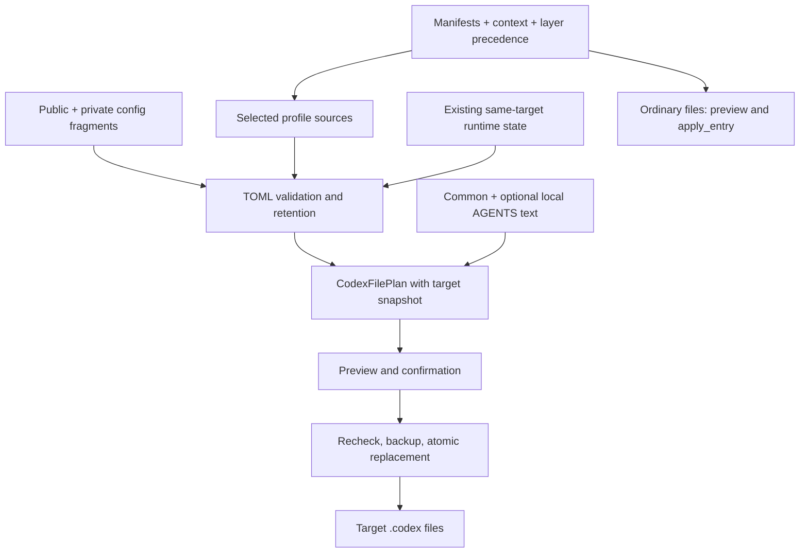

# Managed Codex configuration

The purpose is to reproduce the user's chosen Codex behavior across machines while preserving each target's local state.
The result must support the existing launch/profile commands, separate public policy from private data, and make an authorized update inspectable and recoverable.
The implementation uses the Python standard library; TOML validation/retention requires Python 3.11+.

## Responsibilities and dependencies

| Source or component | Responsibility / consumer |
| --- | --- |
| `config/`, `home/`, `bin/` | Managed payloads for applications, shells, and reusable commands; unrelated payloads stay independent of Codex. |
| `manifest/*.tsv`, `manifest.py`, `context.py`, `planner.py` | Select ordinary files and profiles by local/remote context, then base < private < host precedence. |
| `config.public.toml` | Shared model, execution, permission, TUI, plugin, and memory defaults; consumed by `codex_config.py`. |
| Private `config.private.toml` and optional `config.private.local.toml` | Machine/user data; the local fragment is included only in local context. |
| `*.config.toml` | Separate named profiles; a private/host manifest may replace a profile's complete source. The reviewer role points to the same reviewer file. |
| `AGENTS.common.md` and private `AGENTS.local.extra.md` | Shared working agreements plus local-only guidance; consumed by `codex_agents.py`. An older private common file remains a supported complete override. |
| `codex_runtime.py` | Validate/merge TOML with allowlisted same-target state; snapshot any generated Codex file; back up and replace it safely. |
| `install` | Select sources, preflight selected files, confirm changes, apply them in order, and report status/errors. |
| `apply.py`, `settings_fragments.py`, `reporting.py` | Ordinary manifest copying, optional editor/prompt fragment composition, and text/status presentation. |
| `rules/default.rules`, `plugins/ryo-workflows/`, handoff template | Read-command approval rules, reusable domain workflows, and session handoff guidance; installed as manifest payloads. Vendor caches remain upstream-owned. |
| `../fish/functions/codex.fish`, `../fish/conf.d/95-codex-dgx.fish` | Argument forwarding and the explicit local-model launch abbreviation. Model/profile policy stays in TOML. |

Config fragments concatenate; duplicate TOML keys are errors, not overrides.
Manifest precedence selects complete files, while runtime retention merges only state owned by the deployed target.
These are different contracts and must stay distinct.
All selected Codex plans are built before any file is written, including ordinary files.
Application order is ordinary payloads, base config, selected profiles, then AGENTS.

## Contracts that justify the remaining machinery

- Managed values win; allowlisted plugin/MCP/marketplace, trust, hook activation/state, and UI/migration data survive only from the same target.
- Unknown existing settings, invalid TOML, and type conflicts stop preflight; adding a new runtime-owned field needs an explicit classification.
- Previews for generated Codex files show paths and key names, never values; failure reports omit exception text that could contain private data.
- `--only` matches source/target substrings, including generated fragment paths. A profile-only selection does not read or change the base config.
- Every changed generated file supports preview and `y`/`n`/`q`/`a` confirmation, or `--yes`. Invalid answers reprompt.
- Dry-run does not write files or backups. Unchanged and skipped targets create no backups.
- Before a write, content and mode must still match the snapshot. The previous file is backed up before a temporary sibling is atomically replaced; existing permissions are retained.
- The guarantees are per file, not a multi-file transaction. A later failure lists previously applied/pending files and backups so recovery is explicit.
- Reapplying identical sources and target state makes no changes. Missing retained entries are not implicit deletion requests.

## Evidence and improvement decisions (2026-10-18)

The local deployed base contained 34 project trust entries, 13 plugin entries, one MCP server, and four hook state records.
The actual private checkout supplies common/local config fragments, local AGENTS guidance, and a local deep-profile override.
Fish history contains 193 direct Codex launches, including seven quick and eight deep launches; history is partial and zero matches do not establish an unused workflow.
These observations justify retention, source layering, and named profiles; they do not justify assumptions about all remote hosts.

| Priority | Finding | Decision |
| --- | --- | --- |
| Delete | Base config wrapped an existing runtime plan; profile planning was a forwarding wrapper; AGENTS had another plan type/writer; one text-read helper had no remaining callers. | Remove these internal duplicates. Use one `CodexFilePlan` and writer. |
| Delete | `--only` maintained a second catalogue of profile names, excluded broad TOML selectors, and omitted the local config fragment. | Remove the catalogue; match source/target paths directly, with fragment names taken from their owner modules. |
| Simplify | Base config, profiles, and AGENTS had separate confirmation/application/error paths; AGENTS bypassed confirmation, stale-plan rejection, restrictive-mode retention, and atomic replacement. | Process an ordered list of plans through the existing safe writer and one CLI loop. |
| Preserve | Raw copying/symlinking would remove the runtime merge boundary; profiles, manifests, and local-only fragments serve separate consumers. | Keep these mechanisms and the current config values, permissions, rules, and launch commands. |
| Preserve | Old private common overrides are absent locally, but remote absence is unverified; the forwarding fish function is already deployed. | Preserve compatibility; local absence alone does not authorize retiring a cross-host workflow. |
| Optimize | The baseline suite takes about four seconds; no installer bottleneck or measured optimal model/compaction thresholds was demonstrated. | Reduce maintenance paths first; add no cache, dependencies, or speculative tuning. Current tuning remains user policy, not a measured optimum. |
| Automate | Selection omissions and inconsistent AGENTS safety escaped the existing suite. | Add regression coverage for selection, confirmation/all, stale plans, modes, failed replacement, and reapplication; reuse existing runtime/layer tests. |

## Editing and verification

Edit the public/private/host source that owns the behavior, then use the installer's dry-run and existing authorization workflow described in the [repository README](../../README.md#daily-workflow).
Run `python3 -m unittest discover -s tests -v` from the repository root.
With `DOTFILES_PRIVATE_ROOT` and `DOTFILES_HOSTS_ROOT` set to existing companion checkouts, the optional real-manifest integration case also runs read-only.
Use an isolated HOME for actual apply/reapply tests; inspect real targets through dry-run until deployment is explicitly requested.
Configuration parsing and fixture tests do not establish live Codex service/account availability or successful remote deployment.
