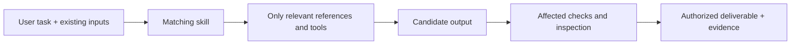

# Ryo Workflows

Reusable Codex workflows with no personal repository paths or host names.

## Purpose and completion

Help Codex produce reproducible configuration, scientific documents, and travel-calendar files without rediscovering fragile domain details.
Keep only guidance or executable checks that change a decision, protect a contract, or prevent a demonstrated failure.
Completion means the requested output is verified at the affected scope, previous successful outputs survive failed candidates, and remaining gaps are explicit.

Preserve managed sources and user edits, scientific and reservation data and meanings, provenance, existing interfaces, and the user's authority over deployment or other external writes.
A skill supplies domain knowledge; it does not grant additional permissions or turn a review into implementation.

## Skills

- `dotfiles-deploy`: managed-source generation, layered planning, and authorized deployment.
- `creating-arxiv-diff-pdfs`: complete PDFs from official arXiv source versions, preserving raw latexdiff output and checking first/middle/last pages.
- `creating-and-editing-typst-figures`: creation, revision, or read-only scientific review of figures in reports, standalone sources, or existing bundles, with input preservation and scoped numerical/rendering checks.
- `export-editable-typst-figures`: portable, editable source/data/helper bundles with extraction history, dependency, relocation, and recipient-integration checks.
- `writing-typst-research-reports`: new reports, revisions, and read-only reviews connecting research questions, scientific evidence, prose, tables, and report composition while inheriting document formatting.
- `extrip-to-ics`: Google Calendar importable ICS files from Japanese train and hotel reservation Markdown, with departure-station and hotel Google Maps links.

## Responsibilities and data flow

| Component | Owns / depends on |
| --- | --- |
| `.codex-plugin/plugin.json` | Plugin identity, discovery directory, and UI metadata; no workflow engine. |
| `skills/*/SKILL.md` | Task selection, scope, essential contracts, and links to relevant details. |
| `skills/*/references/` | Conditional domain procedures and examples; each technical procedure has one owner. |
| arXiv `scripts/verify_diff_pdf.py` | Deterministic build/PDF consistency and sample rendering; requires Python 3, `pdfinfo`, `qpdf`, and `pdftoppm`. |
| Travel `scripts/build_ics.py` | Reviewed events JSON to separate/combined ICS files; Python 3.10+ standard library only. |
| Repository `manifest/base.tsv` and installer | Copy each payload with mode `0644` in local context; registration is a separate boundary. |
| Repository `tests/test_ryo_workflows_plugin.py` | Check the complete manifest payload, actual copying, skill discovery paths, and local reference targets/anchors. |

The workflows stay independent.
Report work owns research questions, evidence and claims, prose, tables, contextual captions, figure selection, and page composition.
Its handoff is question and display requirements → figure creation/revision → verified outputs and referenceable caption ingredients → report integration and whole-document checks.
Existing figures used as-is require only report-side inclusion and interpretation checks.
Figure work uses the existing plotting source and authoritative data/condition/series definitions, without requiring a portable bundle.
Read-only scientific figure review returns evidence-backed findings about displayed values, points, intervals, series, and legends; it leaves sources and delivered artifacts unchanged.
Report arguments, contextual captions, and page composition stay with the report skill; extraction and portability stay with the export skill.
Font-only edits and caption-only tasks retain their existing scope.
[Presentation and Layout](skills/creating-and-editing-typst-figures/references/presentation-and-layout.md) and [Data and Verification](skills/creating-and-editing-typst-figures/references/data-and-verification.md) are its technical sources of truth.
When portability is requested, the export skill adds extraction, dependencies, provenance, relocation, and affected recipient-integration checks through [Data and Provenance](skills/export-editable-typst-figures/references/data-and-provenance.md).
Reading a reference does not start every procedure in the owning skill.
Existing selectors, provenance formats, and condition definitions stay authoritative without a new router, runtime, or mandatory schema.
Dotfiles use the selected source layers and the existing installer rather than adding another deployment system.
arXiv source trees and raw latexdiff output remain immutable; compatibility repairs belong to a separate copy.
Travel conversion follows reservation Markdown → reviewed events JSON → ICS files; extraction remains with Codex because reservation prose varies.
Keep source files, explicit offsets, checkout-day-inclusive stays, departure-station/hotel Maps links, stable IDs, and the existing CLI/JSON interface.
Local file generation needs no calendar API, authentication, or automatic import.

## Source and deployment

The public manifest deploys this plugin to `~/plugins/ryo-workflows` in local context.
Its metadata points to `./skills/`; every referenced resource is deployed with the entrypoint.
Registration and enablement remain explicit local setup, separate from copying these files.

An optional private layer can add repository-specific skills and replace this plugin's
metadata without changing the plugin directory or duplicating the shared skill sources.
Existing private marketplace registration and enablement continue to select that combined plugin.
Use matching public/private source revisions.
When local deployment selects this plugin, the installer refreshes its Codex cache if the local marketplace registration points to this directory and the plugin is already enabled.
It uses `codex plugin add`, verifies the cached payload against the deployed files, and reports failures without undoing deployment.
This also refreshes a stale cache when deployed files already match the sources.
Dry-run only previews the refresh; remote context, unrelated targets, disabled/unregistered plugins, and deployments with declined changes do not refresh it.
Registration and enablement are never created by this refresh.
Start a fresh Codex session after deployment.

The flow is managed sources → manifest selection and optional private overrides → deployed plugin → local registration/enablement → Codex's discovered skill catalog.
Source presence, deployed-file equality, and availability in a running session are separate evidence.
Keep this plugin's skills out of `~/.codex/skills/` to avoid duplicate discovery; that directory is for standalone skills and Codex-managed `.system/` entries.
Archive an existing duplicate outside skill discovery directories before removing it, preserving local edits and verifying the plugin copy.
Do not edit vendor caches to make a source change appear deployed.
Codex's [skill documentation](https://learn.chatgpt.com/docs/build-skills) describes metadata-based discovery and optional supporting resources; no extra public router is needed.

## Evidence and improvement decisions (2026-10-18)

This dated audit describes its historical baseline and decisions, including the five-skill inventory before the later three-way Typst split.
The current responsibilities and file locations are specified above; the audit is not a current inventory or a ban on evidence-based revisions.

The extended audit baseline `8c3ee5f` adds `extrip-to-ics` to `91b2023`: five skills, seven reference documents, two runtime Python helpers, and no hooks, MCP servers, or workflow runtime.
Local report exports and recipient conference bundles contain editable Typst sources, normalization inputs, and panel exporters; these support retaining the portability and provenance contracts.
Partial local prompt history contains 16 figure-skill mentions across 15 sessions, one arXiv-skill mention, and one report-skill authoring request.
These are mentions, not invocation telemetry; zero mentions of a skill name do not establish an unused workflow.
The local deployed plugin and cached catalog also differ from current sources, so neither is evidence that every source skill is available in the current session.
The new travel skill's five standalone tests passed, but the normal repository suite did not discover them and its five files had no manifest rows.
The shared distribution test reproduced the missing skill after a temporary deployment; source presence alone did not satisfy delivery.

| Priority | Observed issue / decision |
| --- | --- |
| Delete | Remove separate arXiv/Typst distribution inventories and README wording assertions. Move travel tests out of the deployed skill into the repository suite; preserve their behavior checks. |
| Simplify | One distribution suite covers all entrypoints/resources and retains the discovery-metadata contract. Keep optional references, public/private boundaries, explicit manifest rows, and conditional report/figure cooperation. Add no router, shared runtime, or packaging generator. |
| Optimize | Keep conditional reference loading. No measured execution bottleneck justifies a cache, new dependencies, or parallel orchestration. |
| Automate | Reject unfinished/erroring TeX logs and log/PDF page-count mismatches; retain reviewable warnings. Register all travel payloads and cover its CLI, grouped/combined files, dates, Maps, UID stability, and output protection in the normal suite. |

A completed TeX summary, matching page counts, valid PDF structure, and rendered sample pages still do not prove source coverage or visual correctness.
The arXiv workflow separately checks expected sections, bibliography, and appendices and inspects rendered pages.
The existing figure/report safeguards already meet the requested scientific-data and delivery constraints; they need no rewrite based on limited usage evidence.
Travel generation already satisfies the tested format and reservation contracts, so its implementation stays unchanged.
Its CRLF/UTF-8 folding, UTC times, and exclusive `DTEND` agree with [RFC 5545](https://www.rfc-editor.org/rfc/rfc5545); checkout-day inclusion remains an explicit workflow convention.

## Validation

From the repository root, run `python3 -m unittest discover -s tests -v`.
For focused checks, select `test_ryo_workflows_plugin.py`, `test_arxiv_diff_pdf_verifier.py`, or `test_extrip_to_ics.py` with `python3 -m unittest discover -s tests -p '<test-file>' -v`.
Run the available skill-creator `quick_validate.py` on each changed skill as well.
The distribution test uses a temporary destination and the actual installer copy function; it does not claim live Codex installation or automatic selection.
For verifier changes, also compile a small complete TeX document and run the helper with its final `.log` and PDF in a fresh verification directory, then inspect the rendered sample pages.
